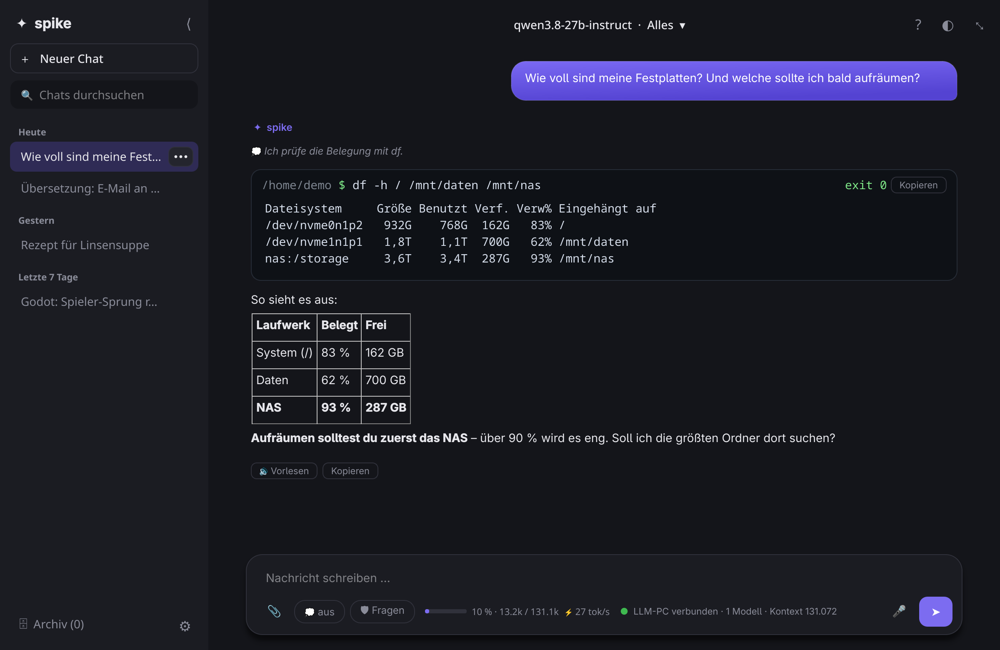
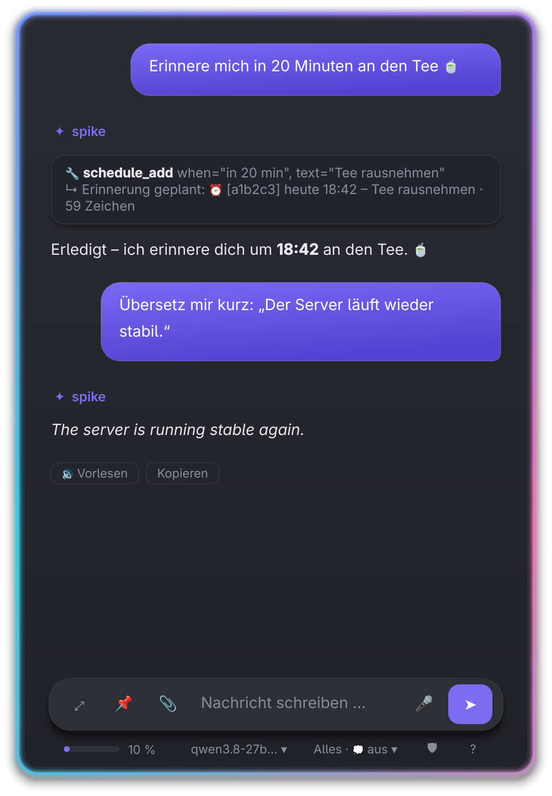
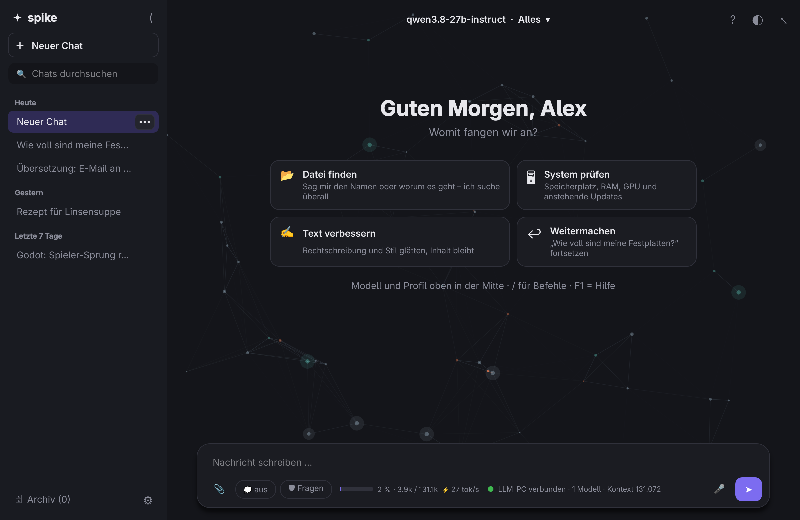

# spike

Leichtgewichtige Desktop-App (Python + Qt) zum Chatten mit mehreren LLM-Servern über die
**OpenAI-kompatible API**, also llama.cpp `llama-server`, Ollama, LM Studio, vLLM, OpenAI, OpenRouter und andere.
Werkzeuge (Websuche, Browser, Shell, Dateien) und System-Prompts pro Profil sind eingebaut.

<p align="center">
  
  &nbsp;
  
</p>
<p align="center">
  
</p>

## Funktionen

- **Mehrere Server und APIs**: Endpunkte mit IP:Port oder URL und optionalem API-Key anlegen, im Chat umschalten,
  Modelle werden automatisch vom Server geladen.
- **Großes Fenster**: Seitenleiste mit Suche (auch im Inhalt der Chats) und Gruppen (Heute, Gestern, Letzte 7 Tage …),
  einklappbar zur Symbolleiste (Strg+B). Oben ein Chip „Modell · Profil ▾“ für Modell, Server, Profil und Denken.
  Die Eingabe ist eine Karte mit Chips für 📎, 💭 Denken, Freigabe-Modus, Kontext und Status. Ein leerer Chat
  begrüßt dich mit Vorschlagskarten (Datei finden, System prüfen, Text verbessern, letzten Chat fortsetzen).
- **Designs**: System (hell/dunkel), Dunkel, Hell, Cyberpunk, Matrix (Monospace-Schrift), Solarized dunkel/hell, Nord,
  Dracula, Gruvbox – unter ⚙ → Design. Jedes Design bringt passende Farben für den Popup-Leuchtrahmen mit.
- **Hintergrund-Effekt** (⚙ → Hintergrund-Effekt): **Röhrenmonitor** mit Scanlines, gewölbten Rändern und einem
  Bildwiederhol-Balken, der hinter dem Chat durchläuft, dazu gelegentliches leichtes Flackern (~1–2 % eines Kerns).
  Oder **Knotenfeld**: wandernde Knoten mit Verbindungen und Signalen, die Maus zieht Knoten an – nur im Chatbereich.
- **Eingabefeld-Stile** (⚙ → Eingabefeld): Standard, Neon-Glow (umlaufender Farbverlauf, pulsiert, leuchtet beim Senden auf), Minimal-Linie (wächst beim Fokus, Lichtpunkt folgt dem
  Cursor) und Glas (Lichtreflex). Animationen laufen nur kurz beim Fokus und Tippen – im Leerlauf braucht spike keine CPU.
- **Profile**: pro Vorgang eigener System-Prompt, Temperatur und Werkzeug-Auswahl (`{date}` wird ersetzt).
- **Werkzeuge**: `web_search` (DuckDuckGo), `fetch_url`, Browser (Playwright: öffnen, lesen, klicken, tippen,
  zurück), `run_shell`, `read_file`, `list_dir`, `write_file`. Shell-Befehle und Schreibzugriffe muss man bestätigen.
- **Rückfragen mit Auswahl** (`ask_user`): Braucht das Modell eine Entscheidung, erscheint im Chat (und auf dem Handy)
  eine Karte mit Antwort-Knöpfen oder – bei `multi` – Häkchen zum Ankreuzen. Freie Antwort geht über das Eingabefeld.
- **Kontext sparen**:
  - Nur die Werkzeuge des aktiven Profils werden ans Modell geschickt.
  - Werkzeug-Ausgaben sind begrenzt (Standard 6000 Zeichen, mit `offset` kann das Modell weiterlesen).
  - Ältere Werkzeug-Ausgaben werden automatisch gekürzt.
  - Das „Denken“ (`reasoning_content`) wird nur angezeigt und nicht zurückgeschickt.
  - Wird der Kontext voll, fallen die ältesten Runden weg.
  - Die Kontextgröße kommt vom Server (`/props`), die Auslastung steht unter dem Eingabefeld.
- **Langer Verlauf** (z. B. beim Programmieren): Ab 70 % Auslastung fasst das Modell den älteren Teil selbst zusammen,
  auch mitten in einer Werkzeug-Kette. Die neuesten ~30 % bleiben wörtlich, Ziel, Pfade und offene Punkte bleiben in der
  Zusammenfassung erhalten. Einstellbar unter ⚙ → Gedächtnis & Kontext.
- **Gedächtnis** (`~/.local/share/spike/memory.json`) mit zwei Arten: **📌 Über dich** (Name, Webseiten, Vorlieben –
  in jedem Chat bekannt) und **🗂 Arbeitsnotizen** (Ordner, Ergebnisse einer Aufgabe – nur, wenn die erste Nachricht
  ausdrücklich dazu passt). Ein neuer Chat ist so ein frischer Start, knüpfst du an („mach weiter mit dem Album“),
  findet das Modell die Notiz mit `memory_search`. Gesucht wird nach ganzen Wörtern („Tag“ findet nicht „Tags“).
  Der Auszug (Standard 1500 Zeichen) bleibt pro Chat gleich, damit der Prompt-Cache von llama.cpp greift.
  Einträge verwalten und Art umschalten: ⚙ → Gedächtnis & Kontext.
- **Dateisuche** (`find_files`, ohne Bestätigung): Systemindex (`plocate`), frische Suche im Home-Ordner (`fd`) und ein
  eigener Index für `/mnt` (NAS, Laufwerke) in `~/.cache/spike/mnt.db`. spike erneuert ihn täglich im Hintergrund
  (niedrigste Priorität, abschaltbar unter ⚙ → Allgemein, sofort mit `/index`). Suche dauert so ~0,1 s.
- **Programmieren**: `read_file` mit Zeilennummern und Abschnitten, `edit_file` ersetzt gezielt Stellen (Freigabe zeigt
  einen farbigen Diff, danach steht die Änderung als Diff-Karte im Chat), `grep` (ripgrep) durchsucht Projekte.
  Relative Pfade gelten ab dem aktuellen Ordner (`!cd projekt`).
- **Anhänge**: 📎, Drag & Drop oder Strg+V (Bilder aus der Zwischenablage). Text-/Code-Dateien und PDFs gehen als Text
  ans Modell (max. 30 000 Zeichen pro Datei), Bilder als Bild – sofern der Server Bilder versteht (llama.cpp mit
  `--mmproj`, erkannt über `/props`). Nur die letzten 3 Bilder eines Chats werden mitgeschickt.
- **Screenshots**: `/screenshot [Frage]` blendet das Popup aus, fotografiert den Bildschirm (Spectacle) und hängt das
  Bild an; das Modell kann mit dem Werkzeug `screenshot` auch selbst nachsehen.
- **Erinnerungen und geplante Aufgaben**: „Erinnere mich in 20 min an den Tee“ → KDE-Benachrichtigung. „Sag mir jeden
  Morgen um 8, wie voll meine Platten sind“ → spike führt den Auftrag zur Zeit selbst aus (ohne Freigaben: alles, was
  bestätigt werden müsste, wird automatisch abgelehnt) und meldet das Ergebnis; „Öffnen“ zeigt den Chat.
  Wiederholung: täglich, werktags, wöchentlich, stündlich, alle N min. Läuft, solange spike läuft (Tray);
  Verpasstes wird beim nächsten Start nachgeholt. `/aufgaben` zeigt alles Geplante.
- **MCP-Server** (⚙ → MCP-Server): fertige Werkzeug-Pakete per Befehl einbinden, z. B. `uvx mcp-server-time` oder
  `npx -y @modelcontextprotocol/server-filesystem ~/Dokumente`. Ihre Werkzeuge heißen `mcp_<server>_<werkzeug>` und sind
  im Profil „Alles“ automatisch dabei. Freigabe: standardmäßig nur bei Werkzeugen, die etwas ändern (readOnlyHint).
  Achtung: Große Server (z. B. GitHub mit ~40 Werkzeugen) kosten viel Kontext – dann lieber ein eigenes Profil.
- **Sprache**: 🎤 bzw. Strg+M – sprechen, nochmal klicken, Text landet im Eingabefeld (faster-whisper lokal, z. B. aus
  pyvideotrans; GPU wenn frei, sonst CPU; oder ein OpenAI-kompatibler Server). 🔊 unter der Antwort bzw. `/vorlesen`
  liest mit der VoxCPM-API vor (Stimme `senol1`), satzweise; spike startet die API bei Bedarf selbst
  (⚙ → Sprache → Startbefehl). `/stop` beendet das Vorlesen.
  Automatische Wahl: GPU frei (≥ 6 GB) oder VoxCPM läuft schon auf der GPU → VoxCPM; GPU voll → **Piper**
  (schnell auch auf der CPU, ~0,3× Echtzeit). VoxCPM auf der CPU wäre ~5× Echtzeit.

Weitere Piper-Stimmen: ⚙ → Sprache → „Stimmen herunterladen …“ (offizieller Katalog, deutsche zuerst),
„▶ Probehören“, im Chat `/stimme <name>`.

Piper und Diktieren installiert `./install.sh --voice --stt` (siehe [Installation](#installation)).
Wer faster-whisper schon anderswo hat (z. B. pyvideotrans), trägt unter ⚙ → Sprache dessen Python ein.

- **Markierten Text bearbeiten**: Text irgendwo markieren, Tastenkürzel für `spike --text` drücken (oder Tray-Menü) →
  Popup mit 🌐 Übersetzen, ✏ Korrigieren, 💡 Erklären, 📝 Zusammenfassen, ↩ Antwort formulieren – oder eigene
  Anweisung tippen. Läuft ohne Werkzeuge und ohne Denken (schnell); Übersetzung, Korrektur und Antwort landen
  automatisch in der Zwischenablage. Tastenkürzel: Systemeinstellungen → Tastatur → Kurzbefehle → „Neu hinzufügen“ →
  „Befehl oder Skript“ → **vollen Pfad** eintragen: `/home/<nutzer>/.local/bin/spike --text` (KDE findet `~/.local/bin`
  sonst nicht: „Programm spike ist nicht auffindbar“).
- **Rückgängig**: Vor jedem `edit_file`/`write_file` wird der alte Stand gesichert (`~/.local/share/spike/backups`).
  „↶ Rückgängig“ an der Diff-Karte oder `/undo` stellt ihn wieder her; wurde die Datei seitdem anders geändert, fragt
  spike nach. Das Modell erfährt, dass die Änderung zurückgenommen wurde.
- **Profil „Alles“**: alle Werkzeuge, das Modell entscheidet selbst. Weitere Werkzeuge: `python_run` (mit Bestätigung)
  und `pc` (Dateien/Programme/URLs öffnen, Zwischenablage, Benachrichtigung, Lautstärke über `wpctl`,
  Medien über MPRIS/`qdbus6`).
- Chats werden lokal gespeichert (`~/.local/share/spike/chats`). Im Verlauf hat jeder Chat ein **⋯**-Menü
  (auch per Rechtsklick): Umbenennen, Archivieren, Löschen. **🗄 Archiv** unten in der Seitenleiste zeigt archivierte
  Chats, dort lassen sie sich wiederherstellen.

## Installation

Voraussetzungen: Linux mit Python ≥ 3.10 und `git` (getestet mit KDE Plasma unter Wayland, CachyOS/Arch).
Debian/Ubuntu brauchen zusätzlich `sudo apt install python3-venv`.

```bash
git clone https://github.com/lon3s/spike.git ~/spike
cd ~/spike
./install.sh --all
```

`--all` richtet alles ein: fehlende Zusatzprogramme (fragt nach dem sudo-Passwort), Autostart im Tray,
Vorlesen mit Piper und Diktieren. Wer es schlanker will, nimmt nur `./install.sh` und hängt einzelne Schalter an:

| Schalter | Wirkung |
|---|---|
| `--deps` | fehlende Zusatzprogramme über den Paketmanager installieren (pacman, apt, dnf, zypper) |
| `--autostart` | beim Anmelden im Tray starten (entfernen: `rm ~/.config/autostart/spike.desktop`) |
| `--voice` | Piper + deutsche Stimme „thorsten-high“ zum Vorlesen, läuft ohne GPU (~110 MB) |
| `--stt` | faster-whisper zum Diktieren (das Sprachmodell, ~1,6 GB, lädt beim ersten Diktieren) |
| `--no-browser` | ohne Playwright/Chromium (spart ~150 MB, dann keine Browser-Werkzeuge) |

Das Skript legt eine eigene Python-Umgebung in `.venv` an, den Befehl `~/.local/bin/spike`, einen Eintrag im
Startmenü und das Symbol. Am Ende zeigt es, welche optionalen Programme fehlen und wofür sie gebraucht werden –
spike läuft auch ohne sie, nur die jeweilige Funktion nicht:

| Programm | wofür |
|---|---|
| `plocate`, `fd`, `ripgrep` | Dateisuche, `grep` in Projekten |
| `wl-clipboard` | Zwischenablage, markierten Text bearbeiten |
| `libnotify` (`notify-send`) | Erinnerungen |
| `kdialog` | sudo-Passwortabfrage |
| `spectacle` | `/screenshot` |
| `pipewire` (`pw-record`), `wireplumber` (`wpctl`), `qt6-tools` (`qdbus6`) | Diktieren, Lautstärke, Mediensteuerung |

**Erster Start:** `spike` im Startmenü oder Terminal. Unter ⚙ Einstellungen → Endpunkte die Adresse des
LLM-Servers eintragen (z. B. `http://192.168.1.50:8080`, siehe unten) → „Verbindung testen“. F1 öffnet die Hilfe.

**Einstellungen von einem anderen PC übernehmen:** den Ordner `~/.config/spike` kopieren, z. B.
`scp -r ~/.config/spike nutzer@neuer-pc:~/.config/`. Er enthält Server, Profile, Aussehen und eigene Werkzeuge.
Achtung: In `config.json` stehen auch API-Keys – nur direkt kopieren, nirgends hochladen.

**Aktualisieren:**

```bash
cd ~/spike && git pull && ./install.sh
spike --quit; spike --tray &
```

**Entfernen:** `spike --quit`, dann `rm -rf ~/spike ~/.local/bin/spike ~/.local/share/applications/spike.desktop
~/.config/autostart/spike.desktop` (Chats und Einstellungen liegen in `~/.local/share/spike` und `~/.config/spike`).

## llama.cpp-Server im Netzwerk erreichbar machen

```bash
llama-server -m modell.gguf --host 0.0.0.0 --port 8080 --jinja -c 16384
# optional mit Schlüssel:  --api-key meinschluessel
```

- `--host 0.0.0.0` ist nötig, damit andere PCs zugreifen können. Ohne diese Option lauscht der Server nur lokal.
- `--jinja` wird für Tool-Calling (Werkzeuge) gebraucht.
- In der App: ⚙ Einstellungen → Endpunkte → `http://192.168.x.y:8080` eintragen → „Verbindung testen“.

Ollama: `http://ip:11434`. OpenAI: `https://api.openai.com` plus API-Key.

## Eigene Werkzeuge (Plugins)

Jede `.py`-Datei in `~/.config/spike/tools/` wird beim Start geladen. Ein Werkzeug sieht so aus:

```python
from spike.plugins import tool

@tool("Aktuelles Wetter für einen Ort.", params={"ort": "Stadt"}, label="Wetter")
def wetter(ort: str, ctx) -> str:
    return ctx.http_get(f"https://wttr.in/{ort}?format=3", headers={"User-Agent": "curl/8"})
```

- Die Parameter liest spike aus der Funktion (`str`, `int`, `float`, `bool`, `list`). Parameter ohne Standardwert sind Pflicht.
- Über `ctx` hat ein Plugin Zugriff auf `http_get`, `html_to_text`, `run("befehl")`, `confirm("Frage?")` und `settings`.
- Mit `confirm=True` fragt spike vor jedem Aufruf nach. Die Rückgabe wird automatisch gekürzt.
- Danach: ⚙ Einstellungen → Allgemein → „Plugins neu laden“, Einstellungen neu öffnen und das Werkzeug im Profil anhaken.
- Dateien, die mit `_` beginnen, werden ignoriert. `_vorlage.py` ist die kommentierte Vorlage.
- Mitgeliefert: `wetter`, `rechner` (exakte Mathematik) und `system_info` (CPU, RAM, Platten, GPU). Sie stehen unter `examples/plugins/` und
  werden beim ersten Start in den Ordner kopiert.

## Tray und Popup

spike hat ein Symbol unten rechts in der Taskleiste (Systemabschnitt):

- **Linksklick**: Das Chat-Popup erscheint unten rechts. Ein Klick daneben schließt es wieder.
- **Rechtsklick**: Menü mit Großes Fenster, Neuer Chat, Markierten Text bearbeiten, Handy verbinden, Hilfe und Beenden.
- **Mittelklick**: großes Fenster.
- Im Popup öffnet ⤢ denselben Chat im großen Fenster, Esc schließt das Popup. Umgekehrt macht das Popup mit dem
  Chat weiter, an dem du zuletzt im großen Fenster gearbeitet hast.
- 📌 im Popup heftet es an: Es bleibt offen, auch wenn du woanders klickst. Ein zweiter Klick löst es wieder.
- Das große Fenster schließen beendet spike nicht, es läuft im Tray weiter. Beenden geht über das Tray-Menü.
- Es läuft immer nur ein spike. `spike` holt das Fenster nach vorn, `spike --popup` schaltet das Popup um,
  `spike --tray` startet nur im Tray, `spike --text` bearbeitet markierten Text, `spike --quit` beendet.
- Tastenkürzel (KDE): Systemeinstellungen → Tastatur → Kurzbefehle → „Neu“ → Befehl → `/home/<nutzer>/.local/bin/spike --popup` (voller Pfad!).
- Autostart: `./install.sh --autostart` (Entfernen: `rm ~/.config/autostart/spike.desktop`).
- Unter KDE/Wayland wird das Popup per layer-shell angedockt. Auf anderen Desktops wird es unten rechts platziert.

## Auf dem Handy

spike bringt eine Handy-Oberfläche mit: einen kleinen Webserver im Heimnetz (nur Python-Standardbibliothek). Der
Chat läuft im Handy-Browser, Modell, Werkzeuge, Dateien und Freigaben bleiben auf dem PC.

1. ⚙ Einstellungen → **Handy** → „Handy-Oberfläche einschalten“ → Speichern. Danach erscheint ein QR-Code
   (braucht das Paket `qrencode`, sonst Link oder Schlüssel abtippen).
2. QR-Code mit der Handy-Kamera scannen. Beim ersten Mal warnt der Browser vor dem selbst erstellten Zertifikat:
   „Erweitert → Weiter“. HTTPS ist nötig, damit das Mikrofon im Browser funktioniert.
3. Im Browser-Menü **Zum Startbildschirm hinzufügen** – dann startet spike wie eine App.

Was geht: alle Chats (dieselben wie am PC, mit Suche, Umbenennen, Archiv, Löschen), Modell/Server/Profil/Denken
wechseln, Freigaben (Ja / Immer / Nein oder „stattdessen …“ schreiben), Live-Ausgabe der Werkzeuge, Dateien und Fotos
anhängen, Mikro gedrückt halten (Whisper auf dem PC), Antworten vorlesen (Piper vom PC, sonst die Stimme des Handys).
Erinnerungen und „wartet auf Freigabe“ erscheinen als Meldung, solange die Seite offen ist.

### Unterwegs mit Tailscale

[Tailscale](https://tailscale.com) verbindet PC und Handy über ein privates, verschlüsseltes Netz – spike ist dann
auch im Mobilfunk erreichbar, ohne Portfreigabe am Router (für private Nutzung kostenlos). Die Anleitung steht auch
in ⚙ → Handy → „Unterwegs mit Tailscale“.

1. PC: `sudo pacman -S tailscale` (andere Distros: `curl -fsSL https://tailscale.com/install.sh | sh`), dann
   `sudo systemctl enable --now tailscaled` und `sudo tailscale up` (Link öffnen, anmelden).
2. Handy: App *Tailscale* installieren, mit demselben Konto anmelden, VPN an.
3. Mit ufw: `sudo ufw allow in on tailscale0 to any port 8765 proto tcp`.
4. ⚙ → Handy neu öffnen und im Auswahlfeld **„Unterwegs – Tailscale“** wählen. spike erneuert dafür das Zertifikat
   automatisch. Diesen QR-Code scannen – der Link funktioniert zu Hause und unterwegs.

Optional ohne Zertifikatswarnung: In der Tailscale-Verwaltung unter DNS „MagicDNS“ und „HTTPS Certificates“
einschalten, dann `sudo tailscale serve --bg https+insecure://localhost:8765`. spike ist danach unter
`https://<pc-name>.<dein-netz>.ts.net` mit gültigem Zertifikat erreichbar (Schlüssel beim ersten Öffnen eintippen).

Sicherheit: Zugang nur mit Schlüssel (steckt im Link/QR-Code, ⚙ → Handy → „Neuen Schlüssel erzeugen“ sperrt alte
Handys aus). **Den Port nie ins Internet freigeben** – spike kann Befehle auf dem PC ausführen. Für unterwegs ein VPN
wie Tailscale (siehe oben) nehmen. Mit Firewall (z. B. ufw) muss der Port im Heimnetz frei sein:
`sudo ufw allow from 192.168.1.0/24 to any port 8765 proto tcp`.

## Bedienung

### Freigaben und Terminal

- Will das Modell etwas am System tun (Shell, Datei schreiben, Python, Öffnen), erscheint im Chat eine Karte:
  **Erlauben**, **Immer: …** (in diesem Chat nicht mehr fragen, bei Shell nur für dasselbe Programm, z. B. `git`)
  oder **Ablehnen**. Schreibst du stattdessen etwas ins Eingabefeld, wird abgelehnt und das Modell bekommt deinen
  Hinweis („nein, nimm lieber …“).
- Shell-Befehle erscheinen als Terminal-Block mit Live-Ausgabe und Exit-Code. Stopp/Esc bricht einen Befehl ab.
- `!befehl` führt selbst etwas im Terminal aus (wie in Claude Code). Die Ausgabe sieht das Modell bei der nächsten
  Frage. `cd` bleibt erhalten, auch für die Befehle des Modells. Interaktive Programme (sudo-Passwort, vim, less)
  gehen nicht. `sudo` geht: Das Passwort fragt ein KDE-Fenster ab (`kdialog`), es geht direkt an sudo und nie an
  das Modell.
- **Denken an/aus** pro Profil (⚙ → Profile oder `/denken an|aus`): Aus ist bei einfachen Aufgaben deutlich schneller
  (Dateisuche: 9 s statt 55 s). Wirkt bei llama.cpp mit Qwen & Co. (`enable_thinking`).
- **Freigabe-Modus** (Chip unter dem Eingabefeld, im Popup das Symbol in der Infozeile, `/modus`):
  🛡 **Fragen** (Standard, vor jeder Aktion), ✎ **Dateien auto** (Dateien ohne Rückfrage, Befehle weiter fragen),
  ⚡ **Yolo** (nichts mehr fragen – Vorsicht) und 👁 **Nur lesen** (nichts ausführen, nur vorschlagen).
  Geplante Aufgaben lehnen Aktionen weiterhin ab, weil dann niemand zuschaut.
- **Nachschreiben**: Während spike arbeitet, einfach weiterschreiben und Enter – die Nachricht wird vorgemerkt (⏳)
  und nach dem nächsten Werkzeug-Schritt mitgegeben bzw. nach der Antwort gesendet. Klick auf ⏳ holt sie zurück.
- Jeder Chat merkt sich seinen eigenen Arbeitsordner (`cd`); ein neuer Chat startet im Home-Ordner.

### Befehle

`/` im Eingabefeld zeigt eine Liste. ↑/↓ wählen, Tab ergänzt, Enter führt aus. Bei `/profil`, `/modell` und
`/server` werden nach dem Leerzeichen die passenden Namen vorgeschlagen.

| Befehl | Wirkung |
|---|---|
| `/new` (`/neu`, `/clear`) | neuer Chat |
| `/compact [Hinweis]` (`/compress`) | Verlauf jetzt zusammenfassen, macht Kontext frei |
| `/kontext` | Kontext-Belegung anzeigen |
| `/profil <Name>`, `/modell <Name>`, `/server <Name>` | wechseln (auch im Popup, wo die Kopfzeile fehlt) |
| `/screenshot [Frage]` | Bildschirmfoto anhängen |
| `/aufgaben` | geplante Erinnerungen/Aufgaben |
| `/vorlesen [Text]` | letzte Antwort vorlesen |
| `/stimme <Name>` | Piper-Stimme wechseln |
| `/undo` | letzte Dateiänderung rückgängig machen |
| `/merk <Text>` | ins Gedächtnis schreiben |
| `/denken [an\|aus\|standard]` | Nachdenken des Modells für das Profil schalten |
| `/modus [fragen\|dateien\|yolo\|lesen]` | Freigabe-Modus wechseln |
| `/stop` | Antwort abbrechen |
| `/gross` | Chat im großen Fenster öffnen |
| `/einstellungen` | Einstellungen |
| `/index` | Laufwerks-Index für die Dateisuche erneuern |
| `/quit` (`/beenden`) | spike beenden |
| `/hilfe` | Bedienungsanleitung (auch F1) |

Im Popup und im Kompakt-Modus zeigt eine Zeile unter dem Eingabefeld die Kontext-Belegung und die Geschwindigkeit
(während der Antwort). Ein Klick auf den Modellnamen wechselt Modell oder Server, ein Klick aufs Profil wechselt
Profil oder „Denken“, **?** öffnet die Hilfe.

**Aussehen des Popups** (⚙ → Popup): Leuchtrahmen (Lauflicht oder Farbverlauf, Farben, Tempo, Breite) und
Hintergrund (Grau, wie das große Fenster oder eigene Farbe; sanfter Verlauf mit Lichtkante; Deckkraft für
Durchsichtigkeit).


- **F1**: Hilfe mit allen Funktionen, Tastenkürzeln und Befehlen.
- Enter sendet, Shift+Enter macht eine neue Zeile, Strg+N startet einen neuen Chat, Esc stoppt.
- **Strg+K**: Kompakt-Modus (nur Verlauf und Eingabe), **Strg+B**: Seitenleiste ein-/ausklappen, ◐: hell/dunkel.
- „Stopp“ bricht die laufende Antwort oder Werkzeugkette ab.

## Lizenz

MIT – siehe [LICENSE](LICENSE). Optionale Zusatzprogramme (z. B. Piper, VoxCPM, faster-whisper, Playwright)
werden nur als eigene Programme aufgerufen und haben ihre eigenen Lizenzen.
